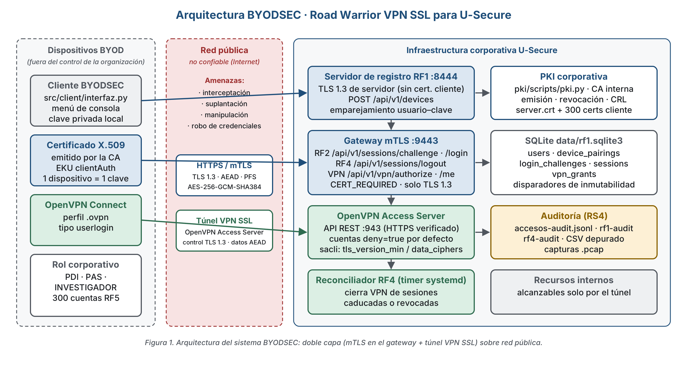
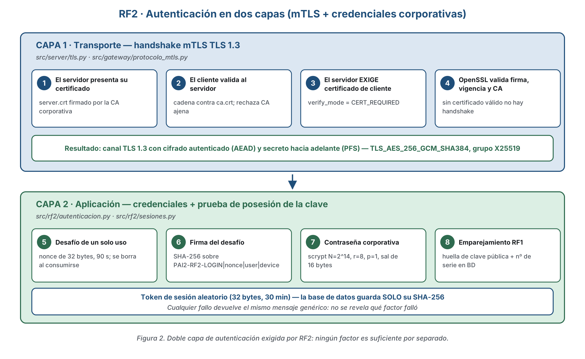
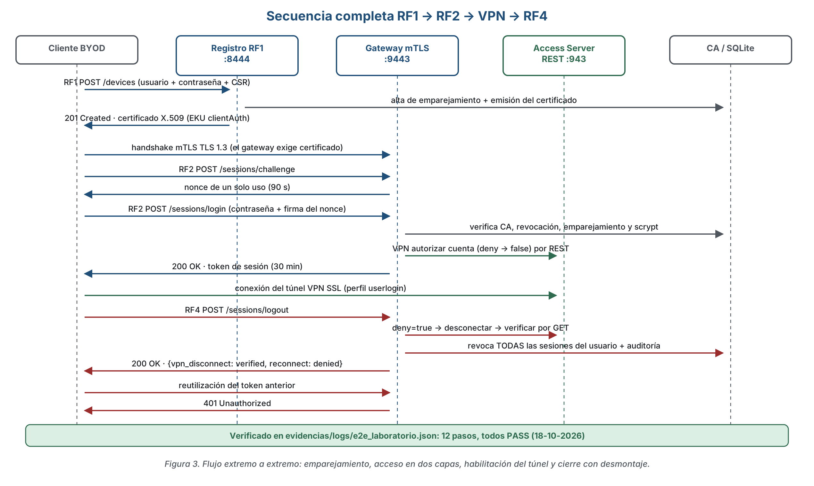
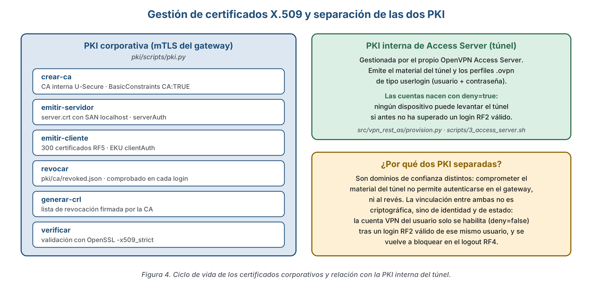
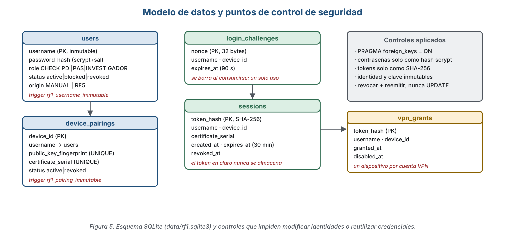
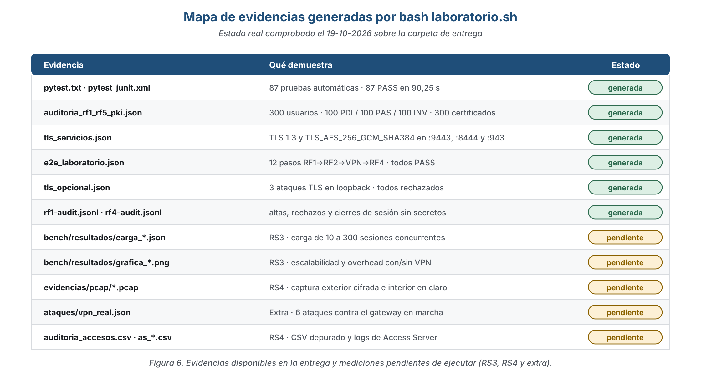

# **PAI 2. BYODSEC:**
Bring Your Own Device Seguro usando Road Warrior VPN SSL
para la *Universidad Pública U-Secure*

**Miembros:**                                         **Grupo:** *13*
*Juan Manuel Vargas Bellido*
*Pablo Morón García*
*Javier Morales Jiménez*

---

# **ÍNDICE**

1. [RESUMEN EJECUTIVO](#1-resumen-ejecutivo)
2. [DISEÑO DEL PROTOCOLO](#2-diseño-del-protocolo)
3. [ANÁLISIS DE SEGURIDAD Y EVIDENCIAS](#3-análisis-de-seguridad-y-evidencias)
4. [MANUAL DE DESPLIEGUE Y USO](#4-manual-de-despliegue-y-uso)
5. [GRADO DE COMPLETITUD](#5-grado-de-completitud)
6. [LIMITACIONES CONOCIDAS](#6-limitaciones-conocidas)
7. [JUSTIFICACIÓN DEL USO DE IA](#7-justificación-del-uso-de-ia)

---

# **1. RESUMEN EJECUTIVO**

La Universidad Pública U-Secure ha adoptado una política **BYOD** que permite al PDI, al PAS y al personal investigador acceder a los recursos corporativos (correo, plataformas docentes, gestión administrativa, repositorios y bases de datos de investigación) desde dispositivos personales y desde redes que la organización no controla. Su política de seguridad exige que **toda** comunicación entre un usuario remoto y los sistemas corporativos discurra por un canal que garantice **confidencialidad, integridad y autenticidad**, y que **solo usuarios, dispositivos y servicios previamente autorizados** alcancen esos recursos.

El proyecto **BYODSEC** implementa esa política mediante un acceso remoto *Road Warrior* de doble capa: un **gateway REST sobre HTTPS restringido a TLS 1.3 con autenticación mutua (mTLS)** que controla quién puede acceder, y un **túnel VPN SSL/TLS gestionado por OpenVPN Access Server** que transporta el tráfico hacia la red interna. Ninguna de las dos capas basta por sí sola: el túnel solo se habilita después de un inicio de sesión válido en el gateway, y el gateway solo atiende a dispositivos que presenten un certificado X.509 emitido por la CA corporativa.

### Decisiones técnicas y algorítmicas adoptadas

| Decisión | Alternativa descartada | Justificación |
|---|---|---|
| **API REST sobre HTTPS/mTLS** (opción 2 de la tabla de capa de transporte del enunciado) | Sockets TLS nativos, gRPC | Permite exigir el certificado de cliente **en cada petición** (`ssl_verify_mode`), se integra con el ciclo de vida de sesiones y es la arquitectura más próxima a una solución profesional de acceso remoto. |
| **TLS 1.3 forzado** (`minimum_version = maximum_version = TLSv1_3`) | Negociación TLS 1.2/1.3 | En TLS 1.3 **todas** las suites son AEAD y el intercambio de claves es efímero por diseño (RFC 8446): PFS y cifrado autenticado quedan garantizados por el propio protocolo, sin depender de una lista de suites permitidas. |
| **mTLS con `verify_mode = CERT_REQUIRED`** y lectura del certificado **del socket TLS**, nunca de cabeceras HTTP | Cabecera `X-Client-Cert` inyectada por un proxy | Una cabecera la puede falsificar el cliente. Leer el certificado del objeto SSL (`src/gateway/protocolo_mtls.py`) hace que la identidad del dispositivo sea la que validó OpenSSL durante el *handshake*. |
| **Desafío firmado de un solo uso** además de la contraseña | Solo usuario/contraseña sobre mTLS | Demuestra **posesión real** de la clave privada asociada al certificado, impide reutilizar una captura de login y bloquea un token robado usado desde otro dispositivo. |
| **scrypt (N=2¹⁴, r=8, p=1, sal de 16 B)** para las contraseñas | SHA-256 con sal | Función de derivación adaptativa: encarece el coste por intento de fuerza bruta, a diferencia de un resumen rápido. |
| **Tokens de sesión almacenados solo como SHA-256** | Token en claro en SQLite | El robo de la base de datos no permite suplantar sesiones activas. |
| **Cuentas VPN creadas con `deny=true`** y habilitadas por REST tras el login | Cuentas VPN siempre habilitadas | Traslada la decisión de acceso al gateway: el túnel es una consecuencia de la autenticación, no una puerta paralela. |
| **Registros de identidad inmutables** mediante disparadores SQLite | Permitir `UPDATE` sobre el emparejamiento | RF1 exige que identidad y clave pública no se modifiquen sin revocación y reemisión explícitas. |
| **Dos PKI separadas** (corporativa para mTLS, interna de Access Server para el túnel) | PKI única compartida | Son dominios de confianza distintos: comprometer el material del túnel no permite autenticarse en el gateway, ni al revés. |

### Objetivos y requisitos de partida

**Objetivos del enunciado:** (1) canales seguros para credenciales y mensajes con TLS; (2) PKI y canal TLS 1.3 con suites robustas y mTLS; (3) evaluación de rendimiento, *overhead* y escalabilidad para 300 empleados concurrentes; (4) verificación y auditoría mediante análisis de tráfico y simulación de ataques; (5) *extra opcional* (+10 %): demostrar resistencia frente a interceptación y suplantación.

**Requisitos funcionales:** RF1 registro de usuarios y emparejamiento de dispositivos con emisión de certificado e inmutabilidad de registros; RF2 inicio de sesión con autenticación en dos capas (mTLS + credenciales); RF4 cierre seguro de sesión con destrucción de claves efímeras y desmontaje del túnel; RF5 precarga de cuentas corporativas de los roles PDI, PAS e Investigador con sus certificados.

**Requisitos de seguridad:** RS1 PKI corporativa y autenticación mutua estricta; RS2 TLS 1.3 exclusivo con suites AEAD y PFS; RS3 300 sesiones simultáneas y comparativa cuantitativa de rendimiento; RS4 capturas `.pcap` que demuestren tráfico cifrado y registros trazables de conexión, desconexión e intentos no autorizados.

---

# **2. DISEÑO DEL PROTOCOLO**

## 2.1 Arquitectura general

La solución se compone de tres servicios en la infraestructura corporativa y un cliente de consola en el dispositivo BYOD. El dispositivo nunca alcanza directamente los recursos internos: debe atravesar primero el gateway mTLS y después el túnel.



*Figura 1. Arquitectura del sistema BYODSEC.*

| Componente | Puerto | Responsabilidad |
|---|---|---|
| **Servidor de registro RF1** | `:8444` | Alta de dispositivos. Usa TLS 1.3 **de servidor** pero **no** puede exigir certificado de cliente, porque el dispositivo aún no lo tiene: es precisamente lo que viene a solicitar. |
| **Gateway mTLS** | `:9443` | RF2 (`/challenge`, `/login`, `/me`), RF4 (`/logout`) y control de la VPN (`/vpn/authorize`, `/vpn/me`). Exige certificado de cliente en el *handshake*. |
| **OpenVPN Access Server** | `:943` REST | Túnel VPN SSL/TLS. Las cuentas nacen bloqueadas y se habilitan por API REST tras un login RF2 válido. |
| **Reconciliador RF4** | *timer* systemd | Cierra por REST las VPN de sesiones caducadas o revocadas, sin depender de que el cliente haga logout. |

## 2.2 Autenticación en dos capas (RF2)

El requisito RF2 pide permitir el inicio de sesión **únicamente** si se supera la validación del certificado del dispositivo *combinada* con el par usuario/contraseña. La implementación encadena ocho comprobaciones, cuatro en la capa de transporte y cuatro en la de aplicación.



*Figura 2. Doble capa de autenticación exigida por RF2.*

En la **capa de transporte**, OpenSSL valida firma, vigencia y emisor del certificado de cliente durante el *handshake*: sin un certificado emitido por la CA corporativa no llega a establecerse la conexión, por lo que la aplicación ni siquiera ve la petición.

En la **capa de aplicación** (`src/rf2/autenticacion.py`) se repiten y amplían las comprobaciones sobre el certificado ya validado —vigencia, emisor, `BasicConstraints`, `ExtendedKeyUsage = clientAuth`, verificación de la firma del emisor y consulta de la lista de revocados— y se añaden tres controles que el transporte no puede hacer:

1. **Consumo del desafío.** El `nonce` de 32 bytes se borra de `login_challenges` en la misma sentencia que lo valida, de modo que un desafío sirve una sola vez aunque el login falle después.
2. **Firma del desafío.** El cliente firma `PAI2-RF2-LOGIN\n<nonce>\n<username>\n<device_id>` con la clave privada del dispositivo; el servidor la verifica con la clave pública del certificado. Esto demuestra posesión, no mera presentación.
3. **Coincidencia con el emparejamiento RF1.** Una única consulta SQL exige que coincidan simultáneamente usuario activo, dispositivo activo, **huella SHA-256 de la clave pública** y **número de serie del certificado**. Solo entonces se verifica la contraseña con scrypt.

Cualquier fallo —contraseña, firma, certificado, emparejamiento o desafío— produce el **mismo** mensaje genérico y el mismo código HTTP 401: no se revela qué factor falló.

## 2.3 Flujo extremo a extremo



*Figura 3. Secuencia RF1 → RF2 → VPN → RF4.*

El **cierre de sesión (RF4)** sigue un orden de fallo seguro deliberado: primero `deny=true` en Access Server para impedir reconexiones, después la desconexión de los túneles activos **y su verificación por GET**, y por último la revocación de **todas** las sesiones RF2 del usuario. Si la API REST falla, las sesiones de aplicación se revocan igualmente y el evento se registra como `session_web_revoked_vpn_unconfirmed` en lugar de `session_closed`: la auditoría nunca afirma que el túnel cayó si no se ha comprobado.

## 2.4 Gestión de certificados



*Figura 4. Ciclo de vida de los certificados corporativos y relación con la PKI del túnel.*

La CA corporativa (`pki/scripts/pki.py`) cubre el ciclo completo: creación de la CA, emisión del certificado de servidor, emisión de los certificados de los 300 usuarios RF5, revocación, generación de CRL y verificación. La revocación se consulta **en cada login**, no solo en el *handshake*, lo que permite invalidar un dispositivo sin reiniciar los servicios.

## 2.5 Modelo de datos



*Figura 5. Esquema SQLite y controles de seguridad asociados.*

La **inmutabilidad exigida por RF1** se implementa en la propia base de datos mediante dos disparadores (`rf1_pairing_immutable` y `rf1_username_immutable`) que abortan cualquier `UPDATE` sobre el nombre de usuario, la huella de la clave pública o el número de serie. Sustituir una clave obliga a revocar el dispositivo y crear un emparejamiento nuevo: no existe camino de modificación silenciosa, ni siquiera desde una consola SQLite.

---

# **3. ANÁLISIS DE SEGURIDAD Y EVIDENCIAS**

## 3.1 Canal seguro y suites criptográficas (RS2)

La herramienta `tools/comprobar_tls.py` abre conexiones reales contra los tres servicios en marcha y registra la versión y la suite negociadas, además de intentar conectar con versiones obsoletas forzando `@SECLEVEL=0` en `openssl s_client` para que el rechazo lo imponga el **servidor** y no el cliente.

**Resultado obtenido** (`evidencias/logs/tls_servicios.json`, 18‑10‑2026):

| Servicio | Puerto | Versión | Cipher suite | TLS 1.2 rechazado |
|---|---|---|---|---|
| Gateway RF2/RF4/VPN (mTLS) | 9443 | TLSv1.3 | TLS_AES_256_GCM_SHA384 | Sí |
| Registro RF1 | 8444 | TLSv1.3 | TLS_AES_256_GCM_SHA384 | Sí |
| Access Server web/REST | 943 | TLSv1.3 | TLS_AES_256_GCM_SHA384 | Sí |

`TLS_AES_256_GCM_SHA384` es una suite **AEAD**, y en TLS 1.3 el intercambio de claves es siempre efímero (ECDHE), de modo que el **PFS está garantizado por el protocolo**. En el lado del túnel, `scripts/3_access_server.sh` fija `tls_version_min` y restringe `vpn.server.data_ciphers` a cifrados AEAD.

> **Pendiente de regenerar.** El fichero de evidencia actual procede de una ejecución anterior a la última ampliación de la herramienta: registra `tls1_2_rechazado` pero no los campos `grupo_pfs` (X25519) ni `versiones_antiguas_rechazadas` (TLS 1.0 / 1.1 / 1.2) que la versión actual del código sí produce. Basta reejecutar `python -m tools.comprobar_tls --json evidencias/logs/tls_servicios.json` para que la evidencia documente explícitamente el grupo efímero y el rechazo de las tres versiones obsoletas.

## 3.2 Ataques controlados (extra, +10 %)

`tools/ataque_opcional.py` levanta un escenario en *loopback* con certificados efímeros y datos ficticios, y comprueba tres propiedades del canal. Resultado registrado en `evidencias/ataques/tls_opcional.json`:

| Ataque simulado | Resultado | Interpretación |
|---|---|---|
| **Suplantación de servidor** con CA desconocida | Rechazado por cliente y servidor; `payload_delivered: false` | El cliente valida la cadena contra `ca.crt`: un servidor impostor no completa el *handshake* y no recibe credenciales. |
| **Cliente sin certificado** (mTLS) | Rechazado; `payload_delivered: false` | `CERT_REQUIRED` impide el acceso de un dispositivo no emparejado. |
| **Cliente con TLS 1.2** | Rechazado; `payload_delivered: false` | El servidor no negocia versiones obsoletas. |

El propio fichero incluye el aviso de que se trata de una prueba de propiedades TLS en *loopback* y que no demuestra por sí sola la protección del túnel en una red real.

> **Pendiente de ejecutar.** `tools/ataques_vpn_real.py` ejecuta seis ataques contra el gateway en marcha (sin certificado, CA ajena, contraseña errónea, suplantación con contraseña de otro usuario, token robado usado con otro certificado y reutilización del token tras el logout), dejando además traza en la auditoría —que es la parte de “identificar” que pide el enunciado—. La evidencia `evidencias/ataques/vpn_real.json` **todavía no se ha generado**.

## 3.3 Rendimiento y escalabilidad (RS3)

El diseño está preparado para 300 sesiones concurrentes y las herramientas de medición están implementadas (`tools/carga_gateway.py` para la concurrencia de autenticación, `tools/medir_cliente.py` para la comparativa con y sin túnel, `tools/graficas_rendimiento.py` para las gráficas), pero **las mediciones no se han ejecutado**: el directorio `bench/resultados/` está vacío en la entrega.

En consecuencia, esta memoria **no presenta cifras de rendimiento**, porque no existen datos medidos que respalden ninguna. Al completar el procedimiento documentado en `docs/procedimientos_6_10.md` §7–8 deberán incorporarse aquí:

| Concurrencia | Conexiones OK / error | Latencia media / p95 (ms) | Throughput (ciclos/s) | CPU / RAM del gateway |
|---|---|---|---|---|
| 10 | *pendiente* | *pendiente* | *pendiente* | *pendiente* |
| 50 | *pendiente* | *pendiente* | *pendiente* | *pendiente* |
| 100 | *pendiente* | *pendiente* | *pendiente* | *pendiente* |
| 200 | *pendiente* | *pendiente* | *pendiente* | *pendiente* |
| **300** | *pendiente* | *pendiente* | *pendiente* | *pendiente* |

| Escenario | Throughput (Mbit/s) | RTT medio (ms) | Overhead frente a directa |
|---|---|---|---|
| Conexión directa sin cifrar | *pendiente* | *pendiente* | — |
| A través del túnel VPN TLS | *pendiente* | *pendiente* | *pendiente* |

Debe señalarse, además, una limitación de licencia: **OpenVPN Access Server en su versión gratuita admite 2 túneles simultáneos**. Por eso la concurrencia de 300 se demuestra sobre el **gateway mTLS** —la pieza que autentica cada acceso y la que el enunciado pide “preparar”— con los 300 usuarios RF5 reales, mientras que la comparativa de *overhead* se mide sobre el túnel con un número reducido de conexiones. Se trata de una restricción de licencia, no de diseño, y conviene explicitar que **300 cuentas con certificado no equivalen a 300 túneles activos**.

## 3.4 Auditoría y trazabilidad (RS4)

El módulo `src/common/auditoria.py` centraliza el registro de eventos en formato JSONL e **ignora activamente** cualquier campo cuyo nombre esté en una lista de prohibidos (`password`, `token`, `signature`, `nonce`, `private_key`…), de modo que un error de programación no pueda escribir un secreto en disco. Cada línea contiene marca temporal UTC, evento, resultado, usuario, dispositivo, motivo público del rechazo y componente emisor.

Evidencia disponible (`evidencias/logs/`):

```
rf1-audit.jsonl   device_registered · registration_rejected (device_already_registered)
                  registration_rejected (invalid_credentials)
rf4-audit.jsonl   session_closed  (dos cierres verificados)
```

> **Pendiente de ejecutar.** Faltan tres piezas de RS4: las **capturas `.pcap`** (exterior cifrada e interior en claro, `scripts/manual/capturar_trafico.sh` y `capturar_tunel.sh`), el **CSV depurado** de accesos (`tools/exportar_auditoria_csv.py`) y los **registros de Access Server** de conexiones, desconexiones e intentos fallidos (`scripts/manual/exportar_logs_as.sh`). El fichero `accesos-audit.jsonl` tampoco se ha generado aún, al no haberse ejecutado los ataques del punto 3.2. El procedimiento completo está en `docs/procedimientos_6_10.md` §9.

El contraste previsto es: en la captura **exterior** el tráfico debe aparecer como TLS 1.3 / OpenVPN ininteligible (`tls.handshake.type==2`, sin contenido legible), mientras que en la captura **interior** del túnel el mismo tráfico HTTP contra el recurso interno aparece en claro. La diferencia entre ambas capturas es la demostración de que la información viajaba cifrada por la interfaz pública.

## 3.5 Pruebas automáticas

La batería completa consta de **87 pruebas** distribuidas en 18 ficheros, ejecutadas de forma aislada (SQLite, PKI y logs temporales). Última ejecución registrada el **18‑10‑2026: 87 pasadas, 0 fallidas, 90,25 s** (`evidencias/logs/pytest.txt` y `pytest_junit.xml`).

Entre ellas, las de mayor valor para los requisitos de seguridad son: `test_mtls.py` (sockets TLS reales, incluido el rechazo de un cliente TLS 1.2), `test_pki.py` (validación con `openssl -x509_strict`), `test_rf2_rf4.py` (11 pruebas: contraseña, firma, certificado ajeno, desafío reutilizado, HTTP plano, bloqueo, revocación y caducidad), `test_rf2_rf4_mtls_integracion.py` (token robado usado con otro certificado) y `test_vpn_refuerzo_rf1_rf2_rf4.py` (inmutabilidad RF1 en SQLite, segundo dispositivo, compensación ante fallo de `authorize`).

La prueba extremo a extremo contra los servicios reales (`evidencias/logs/e2e_laboratorio.json`) recorre **12 pasos** —RF1 201/409/401, RF2 200 y 401, VPN 200 y 409, RF4 200 con token posterior 401 y desconexión verificada, y rechazo de cliente sin certificado— **todos con resultado PASS**.

---

# **4. MANUAL DE DESPLIEGUE Y USO**

## 4.1 Requisitos previos

- **Windows con WSL2 y Ubuntu 24.04 o 26.04**, o Ubuntu nativo.
- Conexión a Internet y contraseña de `sudo`.
- Para las pruebas manuales del túnel: **OpenVPN Connect** y **Wireshark** en el equipo cliente.

## 4.2 Despliegue con un solo comando

Todo el laboratorio se monta, arranca y prueba con una única orden. Desde **PowerShell**, en la carpeta del proyecto:

```powershell
wsl bash laboratorio.sh
```

o, dentro de Ubuntu:

```bash
bash laboratorio.sh
```

Sin argumentos, `laboratorio.sh` ejecuta en orden:

1. **Dependencias** (`scripts/1_dependencias.sh`): comprueba Ubuntu/WSL2, systemd y `/dev/net/tun`; instala `openssl`, `curl`, `gnupg`, `iproute2`, `tcpdump` e `iperf3`; crea el entorno Python en `~/.local/share/byodsec/venv`.
2. **PKI y usuarios** (`scripts/2_pki_y_usuarios.sh`): crea la CA corporativa, el certificado del servidor y los **300 usuarios RF5** con su certificado.
3. **Access Server** (`scripts/3_access_server.sh`): instala y configura OpenVPN Access Server desde el repositorio oficial verificado por huella, con HTTPS propio verificable, TLS 1.3 mínimo, `data_ciphers` AEAD, API REST y un administrador local con contraseña aleatoria.
4. **Servicios** (`scripts/4_servicios.sh`): arranca el gateway mTLS en `:9443`, el registro RF1 en `:8444` y el *timer* systemd del reconciliador RF4.
5. **Pruebas** (`scripts/5_pruebas.sh`): ejecuta **toda** la batería y escribe las evidencias en `evidencias/`, con el resumen en `evidencias/logs/resumen_pruebas.txt`.
6. **Menú del cliente**: abre la consola interactiva.

El script es **idempotente**: puede relanzarse sin perder la CA, las cuentas ni las claves. La primera ejecución tarda varios minutos. Si WSL no tiene systemd activado, el script lo activa y pide ejecutar `wsl --shutdown` antes de relanzarlo.

### Órdenes disponibles

| Orden | Efecto |
|---|---|
| `bash laboratorio.sh` | Instalar + arrancar + probar + menú (por defecto) |
| `bash laboratorio.sh instalar` | Dependencias, PKI, 300 usuarios y Access Server |
| `bash laboratorio.sh arrancar` | Gateway `:9443`, registro `:8444` y reconciliador RF4 |
| `bash laboratorio.sh probar` | Toda la batería de pruebas y evidencias |
| `bash laboratorio.sh menu` | Consola interactiva del cliente |
| `bash laboratorio.sh estado` | Diagnóstico de servicios, puertos y última batería |
| `bash laboratorio.sh parar` | Detiene gateway y registro |
| `bash laboratorio.sh entregar` | Genera `../PAI2-STX.zip` comprobando que no contiene secretos |

Opciones: `--sin-vpn` (todo salvo Access Server, útil para diagnóstico) y `--sin-menu`.

## 4.3 Funcionalidades del cliente

El menú de consola (`src/client/interfaz.py`) expone las funcionalidades principales:

| Opción | Función | Requisito |
|---|---|---|
| **1** | **RF1 · Registrar dispositivo** — genera la clave en el equipo, envía la solicitud al registro `:8444` y recibe el certificado | RF1 |
| **2** | **RF2 · Iniciar sesión** — usuario + contraseña + certificado (desafío firmado) | RF2 |
| **3** | **RF2 · Consultar sesión** — `GET /api/v1/sessions/me` | RF2 |
| **4** | **RF4 · Cerrar sesión** — revocación y comprobación de que el token queda inservible (HTTP 401) | RF4 |
| **5** | **RF5 · Usuarios corporativos** — estadísticas locales de la base de datos | RF5 |
| **6** | **Auditoría** — eventos RF1 y RF4 sin secretos | RS4 |
| **7** | **Demostración completa** — login → consulta → logout → 401 | RF2, RF4 |
| **8** | **Inspeccionar certificados** — certificados de cliente presentes en el equipo | RS1 |
| **9** | **Estado VPN real** — consulta REST del usuario autenticado | VPN |
| **0** | Salir (ofrece cerrar la sesión antes) | RF4 |

**Usuario de prueba:** `rf5_inv_001`. Su contraseña se genera localmente y está **solo** en `pki/clients/rf5/credenciales.csv`, que no se entrega. El perfil VPN se encuentra en `~/.config/byodsec/clients/rf5_inv_001.ovpn` y se importa en OpenVPN Connect; `bash laboratorio.sh estado` muestra su ruta en Windows. El panel de Access Server está en `https://localhost:943/admin/` (usuario `openvpn`, contraseña en `~/.config/byodsec/laboratorio.env`).

## 4.4 Pruebas manuales que requieren el túnel real

No son automatizables porque necesitan OpenVPN Connect conectado:

1. Importar `rf5_inv_001.ovpn`, iniciar sesión con la opción 2 y conectar el túnel; la opción 9 debe mostrar `Conectado: True`.
2. Recurso interno: `python -m tools.recurso_interno_vpn --host <IP as0t*>` en Ubuntu y `py -m tools.probar_tunel --fase sin-vpn|con-vpn|tras-logout --ip <IP>` en el cliente.
3. RF4 real: logout desde la opción 4 y comprobar que el túnel cae y no puede reconectarse sin un nuevo login.
4. RS4: `sudo bash scripts/manual/capturar_trafico.sh eth0` durante la conexión.
5. RS3: `bash scripts/manual/medir_iperf.sh <IP> directa` y `… vpn`.

---

# **5. GRADO DE COMPLETITUD**

Estado comprobado sobre la carpeta de entrega el **19‑10‑2026**.



*Figura 6. Evidencias disponibles y mediciones pendientes.*

## 5.1 Matriz de trazabilidad

| Req. | Qué exige el enunciado | Implementación (fichero) | Prueba | Evidencia | Estado |
|---|---|---|---|---|---|
| **RF1.a** Registro de credenciales y certificado | Alta de usuario/contraseña ligada a la emisión del certificado | `src/server/app.py`, `src/gateway/ejecutar_registro.py`, `src/server/usuarios.py` | `test_rf1_registration.py` (4) | `e2e_laboratorio.json`: HTTP 201 + certificado emitido | ✅ **Cumplido** |
| **RF1.b** Rechazo de dispositivo duplicado | Un `device_id` no puede emparejarse dos veces | `src/common/base_datos.py` (PK + UNIQUE) | `test_rf1_registration.py` | `e2e`: HTTP 409 | ✅ **Cumplido** |
| **RF1.c** Inmutabilidad de registros | Identidad y clave pública no modificables sin revocación y reemisión | Disparadores `rf1_pairing_immutable`, `rf1_username_immutable` | `test_vpn_refuerzo_rf1_rf2_rf4.py::test_rf1_inmutabilidad_sqlite_y_revocacion_permitida` | Prueba PASS (`pytest.txt`) | ✅ **Cumplido** |
| **RF2.a** Validación previa del certificado (capa de transporte) | mTLS obligatorio | `src/server/tls.py` (`CERT_REQUIRED`), `src/gateway/protocolo_mtls.py` | `test_mtls.py` (3), `test_rf2_rf4_mtls_integracion.py` | `e2e` paso RS1: cliente sin certificado rechazado | ✅ **Cumplido** |
| **RF2.b** Credenciales en capa de aplicación | Usuario/contraseña + posesión de clave | `src/rf2/autenticacion.py`, `src/rf2/sesiones.py` | `test_rf2_rf4.py` (11) | `e2e`: login 200, contraseña errónea 401 | ✅ **Cumplido** |
| **RF4.a** Cierre explícito de sesión | Invalidar el acceso | `src/rf4/*`, `src/rf2/sesiones.py::revocar_token` | `test_rf2_rf4.py::test_login_me_logout_*` | `e2e`: logout 200 + token anterior 401 | ✅ **Cumplido** |
| **RF4.b** Desmontaje inmediato del túnel y destrucción de claves efímeras | `deny` + desconexión verificada | `src/vpn_rest_as/rf4.py`, `reconciliar.py` + *timer* | `test_vpn_rest_as.py`, `test_vpn_reconciliar.py` | `e2e`: «VPN bloqueada y desconexión verificada por REST»; `rf4-audit.jsonl` | ✅ **Cumplido** |
| **RF5** 300 cuentas precargadas PDI/PAS/Investigador con certificado | Precarga para pruebas de carga | `src/rf5/gestion.py`, `src/rf5/cli.py`, `scripts/2_pki_y_usuarios.sh` | `test_rf5.py` (6), `test_rf5_recursos.py` (4) | `auditoria_rf1_rf5_pki.json`: 300 usuarios, 100/100/100, 300 certificados verificados, 0 problemas | ✅ **Cumplido** |
| **RS1.a** CA corporativa y ciclo de vida X.509 | Emisión, revocación, CRL | `pki/scripts/pki.py` | `test_pki.py` (3, con `-x509_strict`) | `auditoria_rf1_rf5_pki.json` | ✅ **Cumplido** |
| **RS1.b** Autenticación mutua estricta | Validación bidireccional | `src/server/tls.py`, `src/rf2/autenticacion.py` | `test_mtls.py`, `test_rf2_rf4.py::test_certificado_revocado_por_ca_rechazado` | `tls_opcional.json`: CA desconocida y cliente sin certificado rechazados | ✅ **Cumplido** |
| **RS2.a** TLS 1.3 exclusivo, rechazo de versiones obsoletas | SSLv3/TLS 1.0/1.1/1.2 descartados | `src/server/tls.py` (min=max=1.3), `scripts/3_access_server.sh` | `test_tls.py` (2), `test_mtls.py::test_mtls_rechaza_cliente_tls_12` | `tls_servicios.json`: TLSv1.3 y `tls1_2_rechazado: true` en los 3 servicios | ⚠️ **Cumplido; evidencia incompleta** — falta registrar el rechazo explícito de TLS 1.0/1.1 (reejecutar `comprobar_tls`) |
| **RS2.b** Suites AEAD con PFS | `TLS_AES_256_GCM_SHA384` o CHACHA20 | TLS 1.3 forzado; `data_ciphers` AEAD en Access Server | `test_tls.py` | `tls_servicios.json`: `TLS_AES_256_GCM_SHA384` | ⚠️ **Cumplido; evidencia incompleta** — falta el campo `grupo_pfs` (X25519) en el JSON |
| **RS3.a** Modelo de concurrencia para 300 sesiones | Arquitectura preparada | `tools/carga_gateway.py`; 300 cuentas RF5 reales | — | — | ⚠️ **Implementado, no medido** |
| **RS3.b** Comparativa cuantitativa cifrado vs. directo | Throughput, RTT y/o CPU/RAM | `tools/medir_cliente.py`, `graficas_rendimiento.py`, `scripts/manual/medir_iperf.sh` | — | `bench/resultados/` **vacío** | ❌ **No ejecutado** |
| **RS4.a** Capturas `.pcap` con tráfico cifrado | Interfaz pública ininteligible | `scripts/manual/capturar_trafico.sh`, `capturar_tunel.sh` | — | `evidencias/pcap/` **vacío** | ❌ **No ejecutado** |
| **RS4.b** Registros trazables de conexión, desconexión e intentos no autorizados | Auditoría sin secretos | `src/common/auditoria.py`, `src/rf4/auditoria.py`, `src/server/app.py::_auditar`, `tools/exportar_auditoria_csv.py` | `test_auditoria.py` (3) | `rf1-audit.jsonl`, `rf4-audit.jsonl` generados; `accesos-audit.jsonl`, `auditoria_accesos.csv`, `as_*.csv` **no generados** | ⚠️ **Parcialmente cumplido** |
| **Extra (+10 %)** Resistir e identificar interceptación y suplantación | Ataques controlados | `tools/ataque_opcional.py` ✅, `tools/ataques_vpn_real.py` | `test_ataque_opcional.py` | `tls_opcional.json`: 3/3 rechazados; `vpn_real.json` **no generado** | ⚠️ **Parcialmente cumplido** |
| **Entregable** Código, tests, logs y trazas | — | 18 ficheros de prueba, `scripts/empaquetar_entrega.sh` | 87 pruebas | `pytest.txt`, `pytest_junit.xml`: **87 PASS / 0 FAIL** | ✅ **Cumplido** (salvo trazas de *sniffer*) |

## 5.2 Resumen del grado de cumplimiento

| Bloque | Cumplido | Parcial | No ejecutado |
|---|---|---|---|
| Requisitos funcionales (RF1, RF2, RF4, RF5) | **4 / 4** | — | — |
| Requisitos de seguridad (RS1, RS2, RS3, RS4) | **1 / 4** (RS1) | 2 (RS2 evidencia, RS4) | 1 (RS3) |
| Extra opcional | — | 1 | — |

La funcionalidad exigida está **implementada y verificada en su totalidad**; lo que falta no es código, sino la **ejecución de las mediciones y capturas** que convierten tres requisitos de seguridad en evidencia entregable. Los procedimientos exactos están documentados en `docs/procedimientos_6_10.md`, puntos 6 a 10.

---

# **6. LIMITACIONES CONOCIDAS**

1. **Licencia de Access Server.** La versión gratuita admite **2 túneles VPN simultáneos**. Existen 300 cuentas con certificado emitido, pero una prueba de 300 túneles reales requeriría licencia u otra infraestructura. Es una restricción de licencia, no de diseño.
2. **Dos PKI independientes.** La PKI del gateway (mTLS) y la interna de Access Server (túnel) son distintas. La vinculación entre ambas es **de identidad y estado**, no criptográfica: la cuenta VPN solo se habilita tras un login RF2 válido del mismo usuario.
3. **Entorno de medición.** Entre Windows y WSL2 la ruta «directa» atraviesa un conmutador virtual y no representa una red real; la comparativa de *overhead* es más representativa entre dos equipos de la misma red Wi-Fi, manteniendo idénticos destino, duración y número de flujos.
4. **Material sensible excluido de la entrega.** No se entregan claves privadas, contraseñas, bases de datos ni perfiles `.ovpn`: cada equipo genera los suyos con `bash laboratorio.sh`. El empaquetado comprueba automáticamente que el ZIP no contiene secretos.
5. **Evidencias pendientes.** RS3 completo, capturas `.pcap` de RS4, CSV de auditoría y ataques contra el gateway real, según el detalle del apartado 5.

---

# **7. JUSTIFICACIÓN DEL USO DE IA**

Durante el desarrollo se han empleado asistentes de inteligencia artificial como herramienta de apoyo a la programación, la revisión de código y la redacción técnica, nunca como sustituto del criterio del equipo. Todo el código generado o sugerido ha sido **leído, comprendido, adaptado y verificado** antes de incorporarse, y su comportamiento se ha comprobado mediante la batería de pruebas automáticas y las ejecuciones reales documentadas en esta memoria.

**Herramientas utilizadas:** *Claude* (Anthropic) y *ChatGPT* (OpenAI) para generación, revisión y auditoría de código, y *GitHub Copilot* integrado en Visual Studio Code como asistente durante la edición.

**Cómo se ha usado.** Para contextualizar las respuestas se proporcionó a los modelos el enunciado del PAI-2, la rúbrica de evaluación, las diapositivas de la asignatura y el estado real del repositorio. Las aportaciones más útiles se concentraron en tres áreas: discusión de alternativas de diseño (sockets TLS frente a REST sobre mTLS), revisión crítica del código en busca de fisuras de seguridad, y redacción de pruebas que cubriesen casos límite.

**Validación y correcciones aplicadas.** La revisión del equipo detectó y corrigió varias propuestas incorrectas o inseguras de los modelos, entre ellas:

- **Lectura del certificado desde una cabecera HTTP.** Una primera sugerencia obtenía la identidad del dispositivo de una cabecera `X-Client-Cert`. Se rechazó por ser falsificable por el cliente y se sustituyó por la lectura del certificado del socket TLS (`src/gateway/protocolo_mtls.py`), que es el que ha validado OpenSSL.
- **Almacenamiento de tokens en claro.** Se corrigió para guardar únicamente el SHA-256 del token en `sessions`.
- **Mensajes de error demasiado informativos.** Las respuestas diferenciaban «contraseña incorrecta» de «certificado no autorizado», facilitando la enumeración de usuarios. Se unificaron en un único mensaje genérico con HTTP 401.
- **Orden del cierre de sesión RF4.** La propuesta inicial desconectaba el túnel antes de bloquear la cuenta, lo que dejaba una ventana para reconectar. Se invirtió el orden (`deny=true` → desconectar → verificar por GET) y se añadió la distinción entre `session_closed` y `session_web_revoked_vpn_unconfirmed` para no registrar un cierre que no se ha confirmado.
- **Hash rápido para contraseñas.** Se sustituyó una propuesta basada en SHA-256 con sal por scrypt con parámetros explícitos.

**Prompts representativos:**

```
"Asume el rol de experto en seguridad de comunicaciones y PKI; revisa esta
 configuración de contexto TLS y señala qué permitiría a un cliente no
 autorizado completar el handshake."

"Dado el requisito RF2 (autenticación en dos capas: mTLS + credenciales),
 identifica qué comprobaciones NO cubre el handshake TLS y deben hacerse en
 la capa de aplicación."

"Revisa este flujo de logout e indica si existe alguna ventana temporal en la
 que un cliente pueda reconectar el túnel tras cerrar sesión."
```

En conjunto, la IA ha acelerado la exploración de alternativas y la detección temprana de errores, pero **las decisiones de diseño, la validación criptográfica y la comprobación experimental han sido responsabilidad del equipo**, y todo lo afirmado en esta memoria está respaldado por evidencias presentes en la entrega o declarado explícitamente como pendiente.
